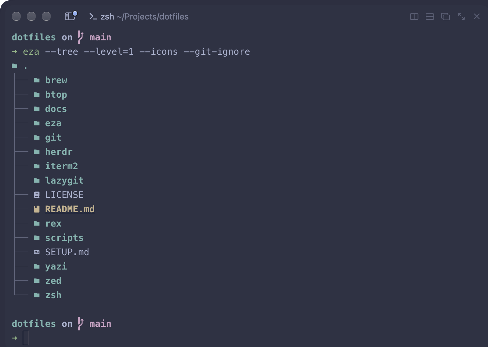
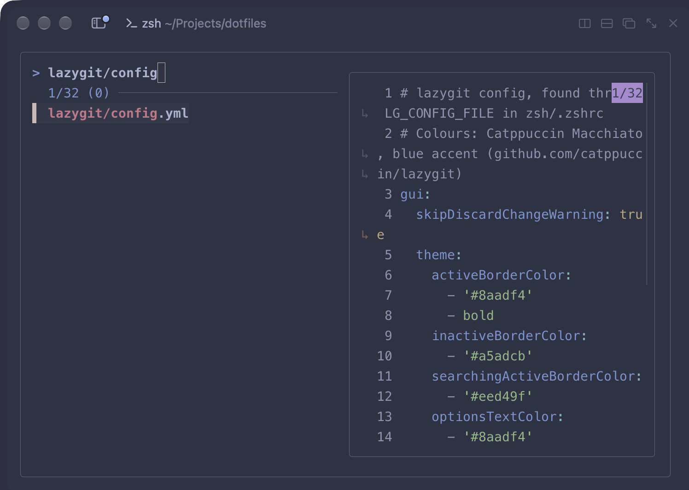
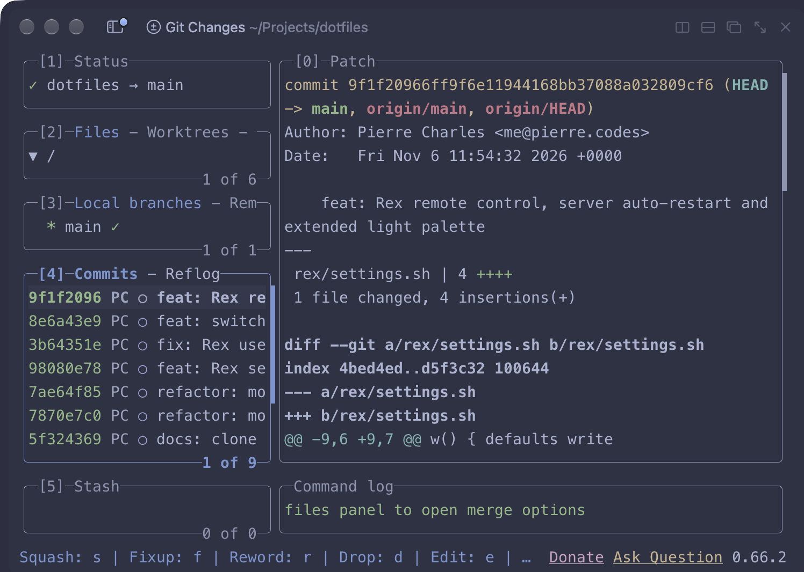
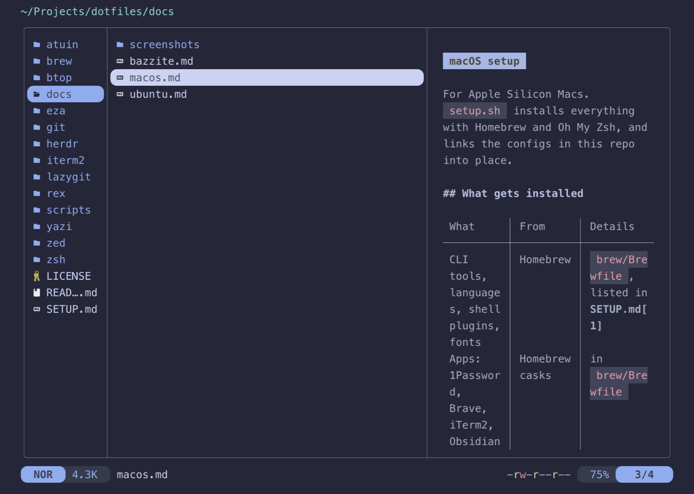
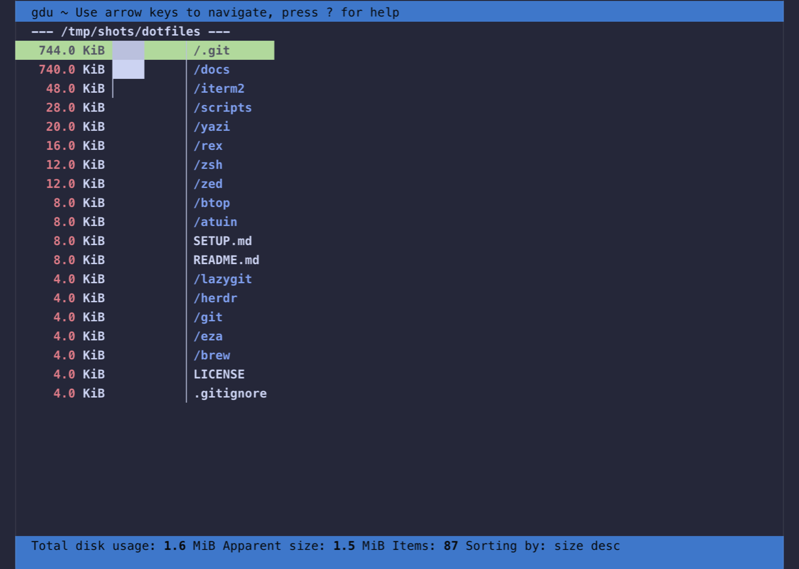
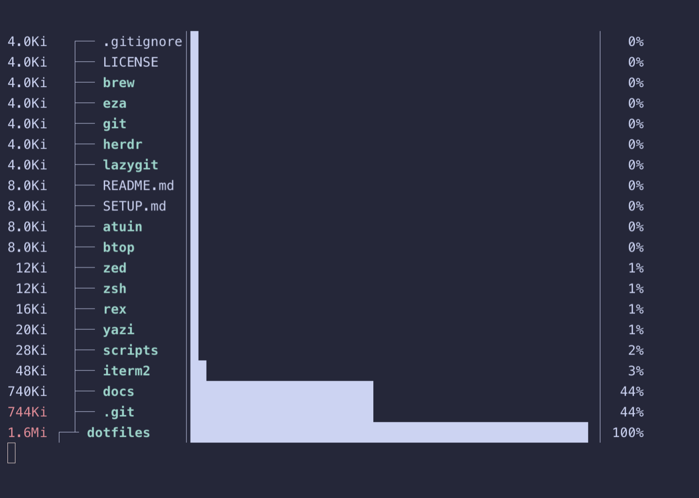
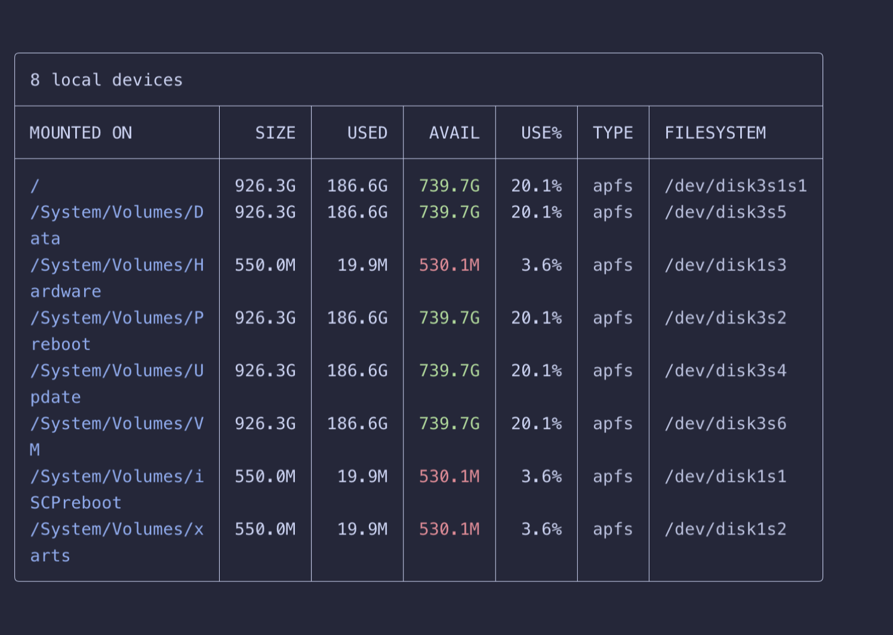
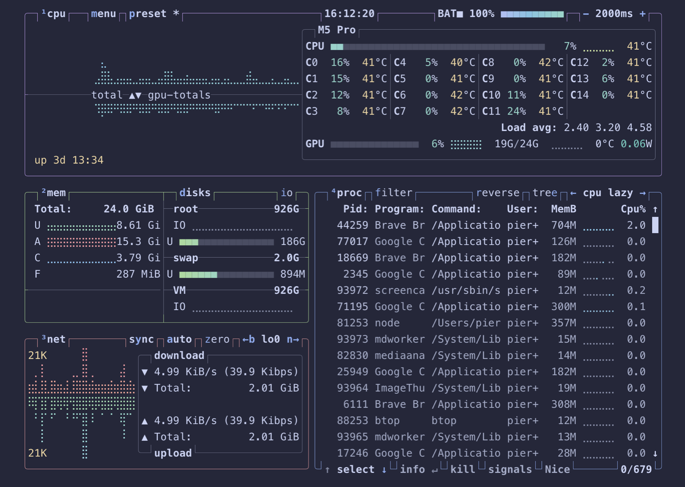
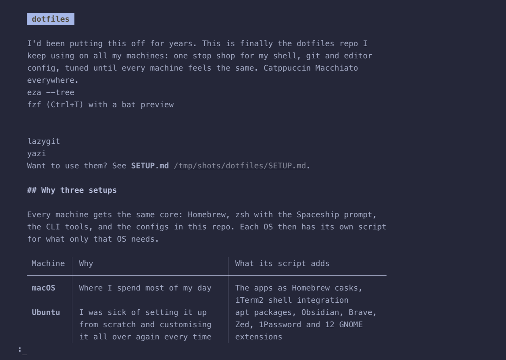
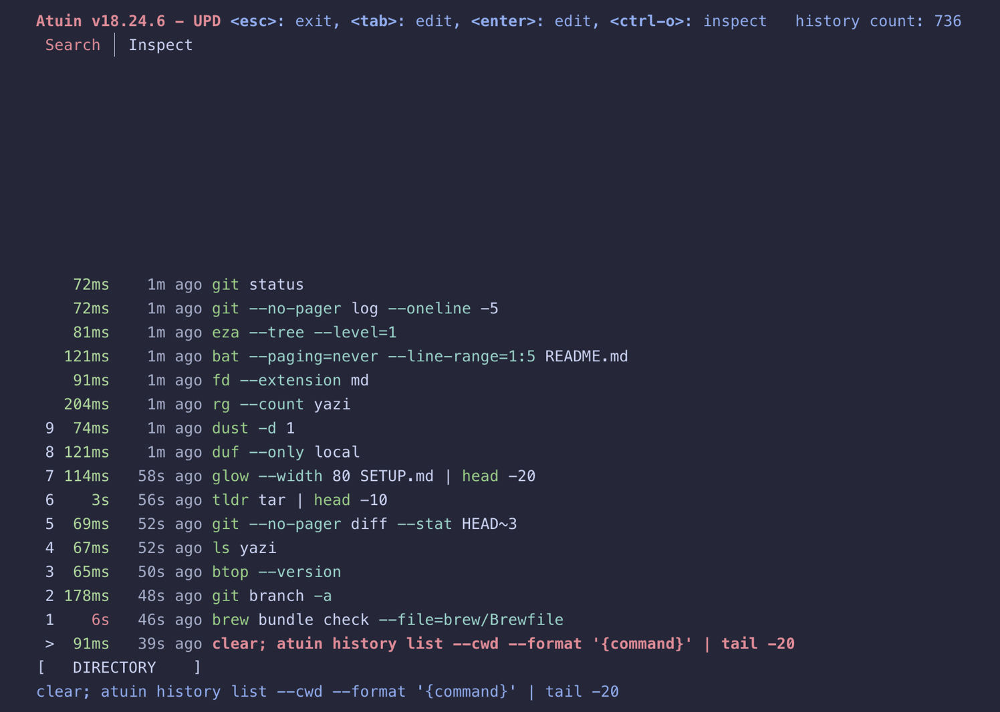

# dotfiles

I'd been putting this off for years. This is finally the dotfiles repo I keep using on all my machines: one stop shop for my shell, git and editor config, tuned until every machine feels the same. Catppuccin Macchiato everywhere.

<table>
<tr>
<td> <code>eza --tree</code></td>
<td> fzf (Ctrl+T) with a <code>bat</code> preview</td>
</tr>
<tr>
<td> lazygit</td>
<td> yazi, with a Markdown preview through glow</td>
</tr>
<tr>
<td> <code>gdu</code>: disk usage you can browse</td>
<td> <code>dust</code>: what's big in a folder</td>
</tr>
<tr>
<td> <code>duf</code>: how full each drive is</td>
<td> btop</td>
</tr>
<tr>
<td> <code>glow README.md</code></td>
<td> atuin (Ctrl+R)</td>
</tr>
</table>

Want to use them? See [SETUP.md](SETUP.md).

## Why three setups

Every machine gets the same core: Homebrew, zsh with the Spaceship prompt, the CLI tools, and the configs in this repo. Each OS then has its own script for what only that OS needs.

| Machine | Why | What its script adds |
|---------|-----|----------------------|
| **macOS** | Where I spend most of my day | The apps as Homebrew casks, iTerm2 shell integration |
| **Ubuntu** | I was sick of setting it up from scratch and customising it all over again every time | apt packages, Obsidian, Brave, Zed, 1Password and 12 GNOME extensions |
| **Bazzite** | My gaming PC, which I keep tinkering with to make it a fullscreen gaming rig | Flatpak apps, Steam starting in Big Picture Mode, KDE set up for a PC that never locks or sleeps |

The Linux scripts run the shared `setup.sh` first, so the shell is the same everywhere and only the desktop differs.

## How the setup works

- **One command per machine.** Clone, run the script for your OS, log out and back in.
- **Safe to re-run.** Anything already installed or linked is skipped, so re-running after a `git pull` picks up only what's new.
- **Carries on past failures.** Each step shows `[✓]` done, `[–]` already done or `[✗]` failed with the reason, and a summary at the end lists every problem.
- **Linked, not copied.** `~/.zshrc`, `~/.gitconfig` and the app configs are links into the repo, so a tweak on one machine is a commit away from all of them.
- **Nothing personal in the repo.** Your git identity and machine-specific shell config live in `~/.gitconfig.local` and `~/.zshrc.local`.

## Which tool for what

The Brewfile installs a lot. These are the ones worth remembering, by what you're trying to do:

| I want to… | Use | Try |
|---|---|---|
| see which drive is full | `duf` | `duf` |
| see what's big in a folder | `dust` | `dust`, `dust -d 1 ~` (one level) |
| dig into disk usage and clean up | `gdu` | `gdu ~`: Enter goes in, `h` goes up, `d` deletes (asks first). `E` saves the scan, `gdu -f <file>` opens it later without rescanning |
| browse, preview, move and rename files | yazi | `y`, keys below. `b` in yazi is a folder's total size |
| jump to a folder I've been to | zoxide | `z part-of-name`, `zi` to pick from a list, `Z` in yazi |
| jump to a fixed place | named directories | `~dotfiles`, `zed ~projects` |
| find a file by name / text in files | `fd` / `rg` | `fd invoice`, `rg "TODO"` |
| pick a file or folder fuzzily | fzf | Ctrl+T, Alt+C, Tab |
| read a file / a Markdown file | `bat` (`cat`) / `glow` | `cat .zshrc`, `glow README.md` |
| stage, commit and branch | lazygit | `lg` |
| read a diff | delta | `git diff`, `git show` |
| check on Docker containers | lazydocker | `lzd`: logs, stats with `]`, restart with `r`, a shell with `E` |
| see what's using CPU and memory | btop | `btop` |
| find a command I ran before | atuin | Ctrl+R |
| remember how a command works | tldr | `tldr tar` |

## Shell shortcuts

What `zsh/.zshrc` and `git/.gitconfig` set up:

| Type | Does |
|------|------|
| `ls`, `ll`, `la`, `tree` | `eza` instead of `ls` and `tree`: `ll` is the long list with icons and git status, `la` adds hidden files |
| `cat` | `bat`: syntax highlighting and line numbers |
| Tab | completions as a searchable fzf list (fzf-tab), with a folder preview for `cd` |
| Ctrl+R | search command history with atuin: filter by folder, session or host |
| Ctrl+T | pick a file and paste its path, with a `bat` preview |
| Alt+C | jump to a folder below. In iTerm this needs **Profiles → Keys → Left Option key: Esc+** |
| Ctrl+G, then a letter | pick git things with fzf and paste them (fzf-git.sh): `B` branches, `H` commits, `F` changed files, `S` stashes, `W` worktrees, `?` for all |
| Esc Esc | put `sudo` in front of the current command, or the last one if the line is empty |
| `y` | yazi file manager. `q` quits into the folder you were in, `z` fuzzy-jumps, Enter opens text files in Zed |
| `lg` | lazygit |
| `lzd` | lazydocker |
| `mkcd <dir>` | make a folder and `cd` into it |
| `copypath`, `copyfile <file>` | copy the current folder's path, or a file's contents, to the clipboard |
| `extract <file>` (or `x`) | unpack any archive: zip, tar.gz, 7z, rar and more |
| `reload` | start a fresh shell after editing `.zshrc` |
| `.envrc` in a folder | loaded when you `cd` in and unloaded when you leave (direnv). Run `direnv allow` once per folder |
| `~projects`, `~dotfiles`, `~worktrees` | named directories: `~dotfiles` on its own goes there, and they work in any path |
| `git diff`, `git show` | shown through `delta`: changed words highlighted, `n` / `N` jump between files |
| `git lg` | compact graph log. Also `git st`, `co`, `br`, `cm`, `df`, `unstage`, `last` |
| `git-remove-gone-branches` | delete local branches whose remote branch is gone (after the PR merged) |
| `worktree-create [base]` | ask for a branch and folder name, create a worktree in `~/Projects/worktrees/<repo>/` and `cd` into it |
| `worktree-init` | inside a new worktree: link `.env.local` from the main one and install dependencies |
| `worktree-clean` | remove worktrees whose branch is merged (checks GitHub PRs for squash merges), after asking |
| `dev [port]` | Next.js dev server on the first free port from 3000 |
| `serve [port]` | static file server for the current folder (Deno), port 8000 |

### yazi keys

Start it with `y`, press `~` inside for the full list.

Plugins (in `yazi/package.toml`): what-size, chmod, smart-enter, toggle-pane, plus git (each file's git status in the list), piper (Markdown previews through `glow`) and full-border (rounded borders).

| Key | Does |
|-----|------|
| `a` | new file. End the name with `/` for a folder (`photos/`) |
| `r` | rename. With several selected, opens all the names in an editor to rename in one go |
| `d` / `D` | move to Trash / delete for good (asks first) |
| `y` / `x` / `p` | copy / cut / paste. `P` pastes over files with the same name |
| `Space` / `v` / `Ctrl+a` | select one and move down / select a range / select all. `Esc` clears |
| Enter or `o` | open: text files in Zed, others in their usual app. `O` lists every way to open it |
| `l` | go into the folder, or open the file (smart-enter plugin) |
| `z` / `/` / `s` / `S` | fuzzy-jump below (fzf) / find in this folder / search names below (fd) / search inside files (ripgrep) |
| `c` `c` | copy the full path |
| `c` `m` | change permissions of the selection, e.g. `770` (chmod plugin) |
| `;` | run a shell command on the selected files |
| `t` `t` | new tab |
| `T` | maximise or restore the preview (toggle-pane plugin) |
| `.` | show or hide hidden files |
| `b` | size of the selection, or of the folder you're in, contents included (what-size plugin, slow on huge folders) |
| `q` | quit into the folder you were in |

## Credits

- [Catppuccin](https://github.com/catppuccin) for the themes (iTerm2, btop, yazi, fzf colours)
- [Oh My Zsh](https://ohmyz.sh), [Spaceship](https://spaceship-prompt.sh), [fzf-tab](https://github.com/Aloxaf/fzf-tab)
- [yazi-rs/plugins](https://github.com/yazi-rs/plugins) (chmod, git, piper, smart-enter, toggle-pane, full-border) and [what-size](https://github.com/pirafrank/what-size.yazi) for the yazi plugins

## License

[MIT](LICENSE)
